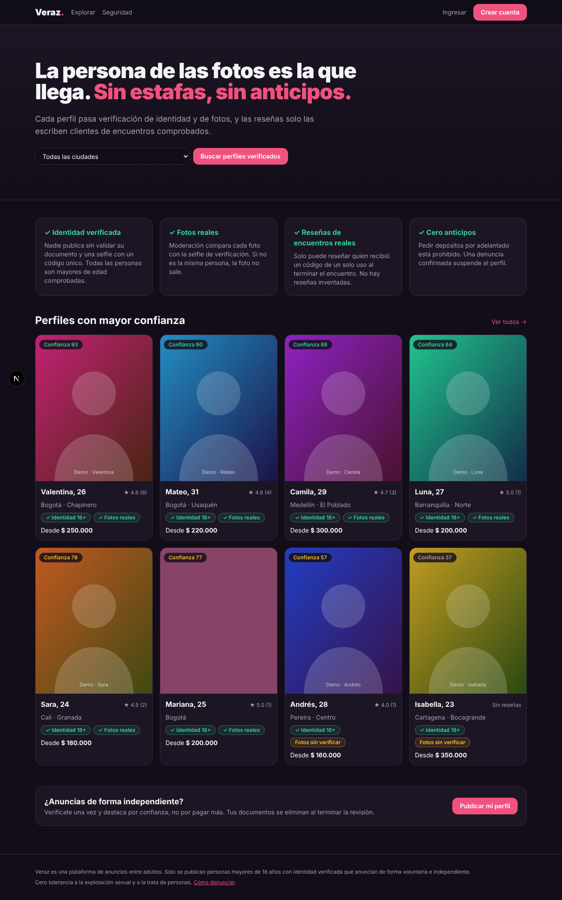

# Sigila

**Discreta para ellas. Segura para ellos.** Plataforma de anuncios de acompañantes (mujeres, hombres y
trans) para adultos, construida alrededor de dos necesidades: **privacidad** para quien anuncia y
**seguridad** para quien busca. «Sigila» es un nombre de trabajo (se cambia en `src/lib/constants.ts`).



## Qué la hace distinta

### Encuentros verificados (reseñas imposibles de inventar)
1. Durante el encuentro, la anunciante genera un **código QR presencial** de un solo uso (15 min).
2. El cliente lo confirma desde su cuenta: queda registrado un encuentro con un **sello público** (`ENC-…`).
3. **Ambos se califican a ciegas**: nada se publica hasta que los dos califican, o pasan 7 días.
4. Cualquiera puede comprobar el sello en `/verificar` sin que se revele la identidad de nadie.

El cliente elige si el texto de su reseña es público o **privado** (solo miembros con cuenta). La
calificación y el sello siempre son visibles.

### Pensada para quien busca
- **Sin registro** para navegar y contactar; si quiere reseñar, **cuenta anónima** (solo contraseña y un alias, sin correo).
- Buscador y filtros que se aplican solos: ciudad, categoría, servicio, lugar, edad, tarifa, disponibles ahora, fotos verificadas, solo independientes.
- **Mensaje de WhatsApp ya armado**: el cliente elige servicio, adicionales (configurados por la anunciante, con precio), lugar y horario.
- **Calificación por servicio**: cada reseña verificada califica solo los servicios tomados.
- **Historias** de 24 horas, como en una red social, para ver quién está activa hoy.

### Independientes, agencias y estafas
- Cada perfil declara si es **independiente** o **agencia/establecimiento**; se muestra en el perfil y hay filtro «solo independientes».
- Detección automática: bloquea anuncios que piden dinero por adelantado, impide repetir un número de WhatsApp en dos perfiles y avisa a moderación cuando una foto coincide con la de otro perfil (huella perceptual).

### Privacidad para quien anuncia
- **Modo discreto**: sin cuenta, las fotos se sirven difuminadas desde el servidor y el contacto queda oculto. El perfil no se envía a buscadores.
- **Bloqueo por ubicación**: por departamento o «fuera de Colombia»; aplica a listados, perfil, fotos, contacto y sellos.
- **Solo visitantes extranjeros**: visible si la conexión es de otro país o el navegador no está en español (indicios, no garantía).
- Documento de identidad **eliminado** al resolver la verificación; metadatos y GPS borrados de las fotos; marca de agua.
- **Pase de cliente**: reputación agregada del cliente (respeto, pago, puntualidad) que él comparte antes del encuentro.

### Seguridad para quien busca
- Nadie se publica sin verificación de identidad y mayoría de edad; las fotos se comparan con una selfie verificada.
- **Disponibilidad real**: «Disponible ahora» vence sola (1–8 h), más horario habitual y «activa hace…».
- Índice de confianza 0–100 transparente (`src/lib/trust.ts`), que no se puede comprar y baja con anticipos o denuncias.
- El número no está en el HTML: se entrega bajo demanda con límite por IP.
- Denuncias: las graves ocultan el perfil de inmediato y van primero en la cola de moderación.

## Puesta en marcha

```bash
pnpm install
cp .env.example .env
pnpm setup        # crea la base SQLite y carga datos de demostración
pnpm dev          # http://localhost:3000
```

| Rol | Correo | Contraseña |
| --- | --- | --- |
| Moderación | `admin@sigila.test` | valor de `SEED_ADMIN_PASSWORD` |
| Cliente | `cliente1@sigila.test` | `demo-cliente-123` |
| Anunciante | `anunciante1@sigila.test` | `demo-anunciante-123` |

El logo está en `public/logo.svg` (con texto) y `public/logo-mark.svg` (solo el símbolo).

Los retratos de demostración son ilustraciones generadas; no hay fotos de personas reales.
Otros comandos: `pnpm test`, `pnpm typecheck`, `pnpm build`.

## Desplegar en Railway

1. En Railway: **New Project → Deploy from GitHub repo** y elige este repositorio y rama. `railway.json` ya define build y arranque.
2. Añade un **Volume** montado en `/data`.
3. Variables: `DATABASE_URL=file:/data/app.db`, `STORAGE_DIR=/data/storage`, `SITE_URL=https://tu-dominio`, `SEED_ADMIN_PASSWORD=<una clave tuya>`.
4. El primer arranque crea las tablas y carga la demo una sola vez (`--if-empty`).

El comando de arranque se probó localmente; el despliegue en Railway en sí no se ha probado. Detrás de Railway no hay
cabeceras de geolocalización: pon Cloudflare delante para que funcione el bloqueo por región.

## Estructura

- `prisma/schema.prisma`: modelo de datos. `src/app/actions/`: toda la lógica de escritura, con validación y permisos.
- `src/lib/`: confianza (`trust`), disponibilidad (`availability`), bloqueo por región (`geo`, `regions`), archivos privados (`storage`).
- `src/app/panel`: cuenta de anunciante y de cliente. `src/app/admin`: moderación. `src/app/e`: confirmación de encuentro.
- `src/app/prepagos/[ciudad]`, `sitemap.ts`, `robots.ts`: base de SEO.
- Interfaz: Tailwind 4, Motion (animaciones), Fraunces + Geist, iconos Lucide.

## Marco legal del diseño

La plataforma **solo publica anuncios**: no agenda, no intermedia, no procesa pagos entre usuarios ni cobra
comisión por los encuentros; exige mayoría de edad verificada y prohíbe administrar perfiles de terceros.
Esto está reflejado en el producto y en los borradores de `/legal/terminos` y `/legal/privacidad`, que
**deben ser revisados por un abogado** antes de lanzar (Ley 1581 de 2012, prevención de explotación sexual
y trata, y la normativa de cada país donde opere).

## Pendiente antes de producción

1. Revisión legal y datos del responsable (razón social, NIT, canal de atención).
2. **Geolocalización**: el bloqueo por región lee las cabeceras del CDN (Vercel o Cloudflare). Sin CDN, la región es desconocida y los perfiles con bloqueos se ocultan a todos. Una VPN lo evita.
3. Proveedor de verificación de identidad con prueba de vida, en lugar de revisión solo manual.
4. PostgreSQL, almacenamiento cifrado (S3 o similar) y limitador de peticiones en Redis.
5. Verificación de correo y teléfono, recuperación de contraseña, 2FA para moderación, registro de auditoría.
6. Modelo de ingresos (suscripción de anunciantes) que no altere el índice de confianza.
